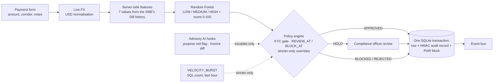
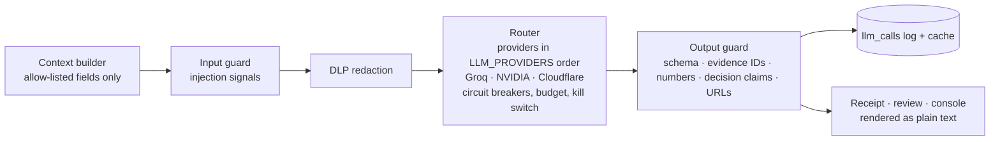
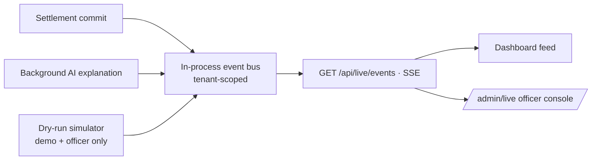

# CrossPay: risk-adaptive cross-border settlement for SMEs

Academic prototype. A KYC-verified SME submits a cross-border payment. CrossPay converts it at a live exchange rate,
scores it with a Random Forest built from the SME's own payment history, and a deterministic policy engine either
approves it onto a signed ledger, holds it for a compliance officer, or blocks it. An optional LLM layer explains
decisions and helps officers, but **never makes a decision**.

Live demo: <https://crosspay-i4gl.onrender.com> (demo mode, one-click SME and officer logins).

> **Honest data caveat.** The model is trained on 6,000 *synthetic* payments from a rule-based generator with
> overlapping classes and 7% label noise. Its metrics describe how well it recovers that generator, not real-world
> fraud detection.

> **Security note.** The removed `_legacy_archive/` folder contained the public Hardhat account #0 private key, Ganache
> keys and other credentials. They remain in git history (commit d12451c). Treat them as compromised; never fund or
> reuse them.

## The problem

SMEs pay suppliers across borders with little room for manual compliance. Rules that are too loose let risky payments
through; rules that are too strict bury officers in reviews. CrossPay adapts settlement to risk, sends only the
uncertain middle to a human, and keeps every decision explainable and tamper-evident.

## Architecture

### Decision path



- Only the amount and corridor come from the form; every behavioural feature is computed on the server
  (`crosspay/services/features.py`).
- `crosspay/policy/engine.py` is the only place a decision is made. AI signals and the velocity rule can only make a
  decision stricter (APPROVED to HOLD); they never lower one.
- `crosspay/services/settlement.py` inserts, decides, mines and signs inside **one** database transaction; the ledger
  explorer view is rebuilt from the HMAC-SHA256 audit chain (`crosspay/ledger/audit.py`).

### Advisory AI layer



Every AI call goes through `crosspay/ai/pipeline.py::run_task()`. The output guard rejects answers that cite unknown
evidence, invent numbers or IDs, or claim or recommend an outcome other than the stored one. Neutral mentions such as
"not yet settled" are allowed. With `LLM_ENABLED=0` the app works fully and nothing calls out.

### Live feed



Events are published only after COMMIT. SMEs receive only their own payments; officers receive everything. The
simulator scores synthetic payments with the real model, policy engine and input guard, but never writes to the
database, the audit chain or the ledger, and makes no AI calls. Its scenarios include velocity bursts, high-risk
corridors, unverifiable invoices, injection-style notes, duplicate submissions and unverified KYC.

The officer console at `/admin/live` shows KPI tiles from the database and a server-measured pipeline p95. It also has
a "Needs a decision" queue of held payments, each with its stored AI one-liner, and a filterable event table. Each row
opens a trace: KYC gate → features → score and top factors → policy reasons → ledger.

## Module map

| Package | What lives there |
|---|---|
| `crosspay/__init__.py` | app factory, extensions, startup (ledger bootstrap, model load, AI backfill), `/healthz` |
| `crosspay/blueprints/` | `auth` (login, demo quick login), `kyc`, `payments` (form, receipt, transactions, dashboard, ledger), `admin` (KYC queue, HOLD review, reports, AI ops, live console), `api` (FX, live feed, AI polling), `ai_features` (assistant, NL filter, invoice, explain) |
| `crosspay/services/` | `features` (server-side features, velocity count), `scoring` (Random Forest + fallback, top factors), `currency` (FX with stale cache), `settlement` (atomic decide-mine-sign) |
| `crosspay/policy/` | `engine.py`: the deterministic decision |
| `crosspay/ledger/` | `chain.py` (PoW blocks, smart-contract simulation), `audit.py` (HMAC chain, fork guard), `filelock.py` |
| `crosspay/ai/` | `pipeline`, `router`, `providers/` (Groq, NVIDIA, Cloudflare, fake), `input_guard`, `guard` (output), `context`, `evidence`, `jobs`, `budget`, `log`, `prompts/`, `tasks/` |
| `crosspay/security/` | `decorators` (login, admin, demo-only), `dlp`, `pii` (encrypted government IDs), `idempotency`, `limiter` |
| `crosspay/realtime.py` | event bus, SSE stream, reason labels, dry-run simulator |
| `model/` | training script, model artefact with checksum, `metrics.json`, model card, AI evaluation sets |
| `templates/`, `static/` | Jinja pages and the "Signed Ledger" design system (tokens, components, motion), vendored fonts and charts |

## Security model

- **Tenant isolation.** SMEs see only their own payments, receipts, AI answers and live events; another tenant's
  record returns 404.
- **CSRF and same-origin.** CSRF tokens cover form posts; JSON APIs require a same-origin `Origin`/`Referer` header on
  unsafe methods.
- **Roles.** Only officers can release or reject holds, open the review, reports, AI ops and live console pages, or
  read the live stats. Demo-only routes (quick login, simulator, demo KYC) return 404 unless `DEMO_MODE=1`.
- **Secrets.** Secrets come only from the environment and nothing secret is committed. `prod` refuses to start
  without `SECRET_KEY` and `LEDGER_SIGNING_KEY`. Government IDs are encrypted at rest. The model file is
  checksum-verified before it is unpickled.
- **AI never decides.** AI output cannot reach the decision except as escalate-only codes. It is rate limited and
  budget-capped, has a kill switch, and is DLP-redacted in both directions. Officers must write their own review
  reason; its similarity to the copilot draft is tracked.

Threats, fixes and residual risks: `docs/THREAT_MODEL.md`.

## Measured model performance

From `model/metrics.json` (time-based 70/15/15 split, test set = newest 900 rows, seed 42):

| Metric | Value |
|---|---|
| Accuracy | 72.9% |
| Macro F1 | 0.700 |
| HIGH-class precision / recall / PR-AUC | 0.660 / 0.840 / 0.801 |
| Brier score (3-class) | 0.383 |
| 5-fold CV accuracy (training period) | 69.7% ± 1.3% |
| Policy at 40/80 on the test set | HIGH auto-approved 0.0% · HIGH blocked 84.0% · LOW approved 78.2% · sent to review 29.8% |

## Run it locally

```bash
python -m venv .venv
.venv\Scripts\pip install -r requirements-dev.txt
copy .env.example .env
.venv\Scripts\python app.py
```

On macOS/Linux use `.venv/bin/...` and `cp`. The app runs at <http://localhost:5000>, and `python app.py 5001` picks
another port. Fill in `SECRET_KEY` and `LEDGER_SIGNING_KEY` in `.env`; AI keys are optional. With `DEMO_MODE=1` the
landing page offers one-click **demo SME** and **compliance officer** logins (`/quick_login/sme`, `/quick_login/admin`).

### Tests

```bash
.venv\Scripts\python -m pytest -q
```

The suite needs no network: FX is mocked and the LLM is a scripted fake. The live red-team run calls the real
providers and is excluded by default; run it explicitly with `pytest -m live_redteam` (needs `GROQ_API_KEY`). CI
runs pytest, `ruff check crosspay tests model app.py --select E,F,W --ignore E501,E402` and CodeQL
(`.github/workflows/`).

## Deploy on Render

`render.yaml` is a Render Blueprint: one web service running gunicorn with a single worker and 16 threads. The live
feed bus, the AI job queue and the rate limiter are in-process, so it must stay one worker. It uses a 1 GB persistent
disk for the SQLite database, ledger and uploads, and `/healthz` as the health check. Secrets are entered in the Render
dashboard (`sync: false`) or generated by Render (`generateValue`). Step by step: `docs/DEPLOY_RENDER.md`.

## Environment variables

Names only; defaults and comments are in `.env.example`, and production values in `render.yaml`.

| Group | Variables |
|---|---|
| Runtime | `CROSSPAY_ENV`, `FLASK_DEBUG`, `PORT`, `DEMO_MODE`, `DEMO_SME_PASSWORD`, `DEMO_ADMIN_PASSWORD`, `TRUSTED_PROXIES` |
| Secrets | `SECRET_KEY`, `LEDGER_SIGNING_KEY`, `KYC_ENCRYPTION_KEY` |
| Storage | `DB_PATH`, `LEDGER_PATH`, `UPLOAD_DIR`, `MODEL_PATH`, `METRICS_PATH`, `MODEL_CARD_PATH` |
| Policy | `REVIEW_AT`, `BLOCK_AT`, `POW_DIFFICULTY`, `INVOICE_REQUIRED_ABOVE_USD`, `VELOCITY_BURST_1H` |
| Exchange rates | `EXCHANGE_RATE_API_KEY`, `EXCHANGE_RATE_API_URL`, `EXCHANGE_RATE_PROVIDER`, `EXCHANGE_RATE_CACHE_TTL`, `EXCHANGE_RATE_TIMEOUT`, `EXCHANGE_RATE_MAX_STALE_HOURS` |
| AI layer | `LLM_ENABLED`, `LLM_PROVIDERS`, `LLM_TIMEOUT`, `LLM_DAILY_BUDGET_USD`, `LLM_LOG_RETENTION_DAYS`, `AI_RATE_LIMIT`, `AI_BACKFILL`, `INPUT_GUARD_ESCALATES`, `AI_EXPLAIN`, `AI_PURPOSE`, `AI_COPILOT`, `AI_INVOICE`, `AI_NLQ`, `AI_ASSIST`, `AI_REPORTS` |
| Providers | `GROQ_API_KEY`, `GROQ_MODEL`, `NVIDIA_API_KEY`, `NVIDIA_MODEL`, `CLOUDFLARE_ACCOUNT_ID`, `CLOUDFLARE_API_TOKEN`, `CLOUDFLARE_MODEL` |
| Rate limiting | `RATELIMIT_STORAGE_URI` |

## AI features and their limits

| Feature | Where | Limit |
|---|---|---|
| Risk explainer | receipt and review page, "Why this decision" + "Explain with AI" | rejected if it cites unknown evidence, invents a number or claims another outcome; backfilled at startup for recent payments, spaced to respect provider rate limits |
| Purpose tagger | on submit | escalate-only (to HOLD); never a model feature |
| HOLD copilot | `/admin/review/<tx>` | no verdict field; the officer's reason must be their own words |
| Invoice reader | payment page (PDF) | an exact text check cross-checks the AI; mismatches only tighten the policy |
| Natural-language filter | transactions | becomes validated filter chips, never SQL; always tenant-scoped |
| SME assistant | receipt | own record + FAQ only; refuses evasion and other customers; 10 questions per payment per day |
| Report drafts | `/admin/reports` | numbers must come from the database; DRAFT until an officer signs |
| Live one-liner | dashboard feed, `/admin/live` | the stored explanation summary, labelled "AI · advisory" |
| Self-test | `/admin/ai` | runs every feature once on a synthetic case and shows OK / REJECTED_GUARD / UNAVAILABLE |

Evaluation: `docs/AI_EVALUATION.md`. Guardrails and red-team results: `docs/AI_GUARDRAIL_MATRIX.md`,
`docs/AI_REDTEAM_REPORT.md`.

## Documentation

| Document | Contents |
|---|---|
| `docs/THREAT_MODEL.md` | assets, threats, mitigations, residual risks |
| `docs/AI_GUARDRAIL_MATRIX.md` | each guardrail with its test and remaining gaps |
| `docs/AI_REDTEAM_REPORT.md` | latest live red-team run |
| `docs/AI_EVALUATION.md` | golden-set evaluation of the explainer and purpose tagger |
| `docs/DEPLOY_RENDER.md` | Render deployment steps |
| `docs/VIVA_DEMO.md` | demo script |
| `docs/REUSE_INVENTORY.md` | what was reused from earlier projects and why |
| `CHANGELOG.md` | every change, by phase and finding ID |
| `DESIGN.md`, `design-work/` | design direction, tokens, components, motion, QA report |
| `PROJECT_INTELLIGENCE_DOCUMENTATION.md` | the original project write-up (metrics updated) |

## Known limitations

- Synthetic training data; the metrics above do not measure real-world fraud detection.
- SQLite and an in-process event bus, job queue and rate limiter mean one server process (one gunicorn worker).
- The Solidity contract in `blockchain/smart_contract.sol` is a reference design, never deployed; the UI labels the
  address as simulated. The "ledger" is a PoW hash chain inside the app, not a public blockchain.
- Free-tier LLM providers rate-limit bursts; when they do, AI features show "unavailable" and the app keeps working.
- Leaked legacy keys remain in git history until it is rewritten.

## Credits and licences

Third-party assets (fonts, Chart.js, anime.js) and their licences: `THIRD_PARTY_NOTICES.md`. Parts of the event bus,
policy engine and output guard are adapted from the author's own projects: Netvrio
(`sandysunny99/razorpay-ai-risk-manager`) and Aegis Node (`sandysunny99/aegis-node`, MIT). Each file names its source
in its header.
